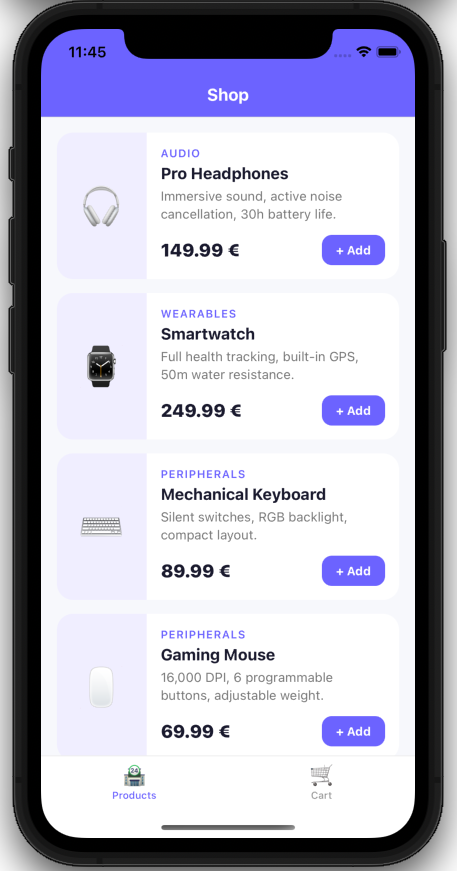
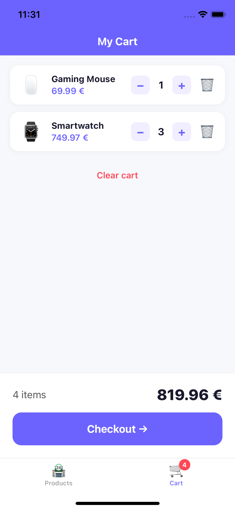
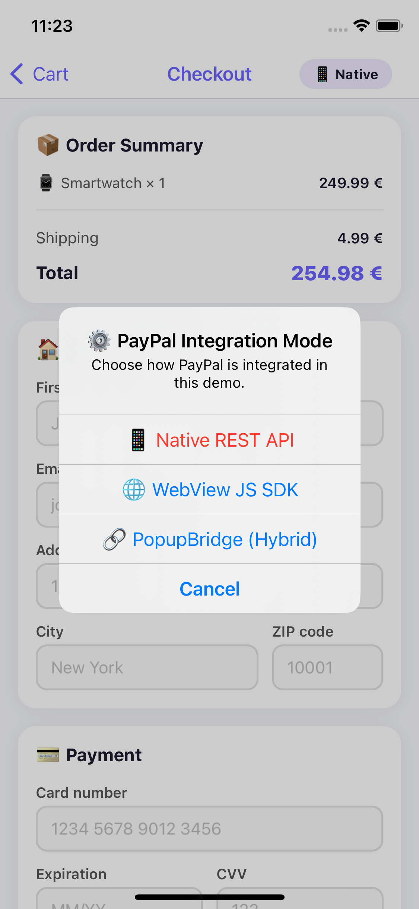
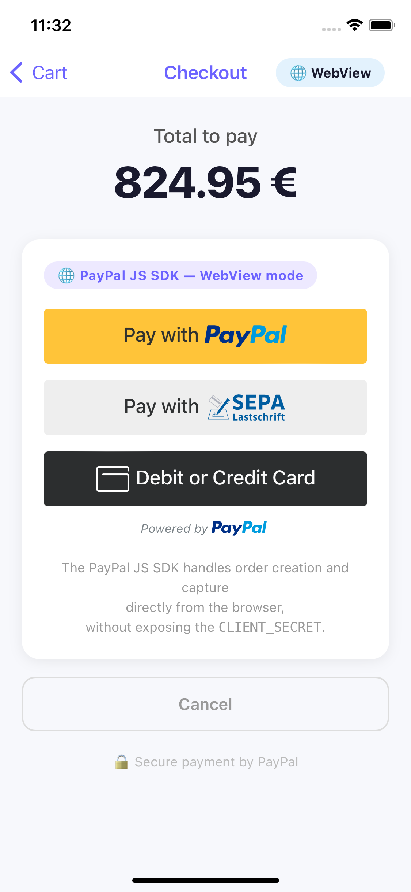
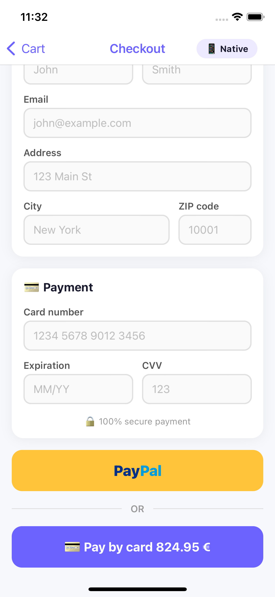
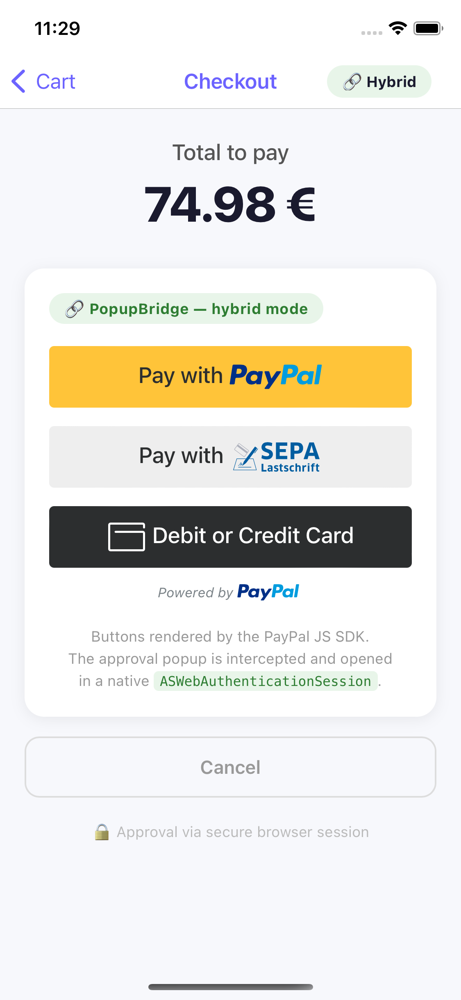
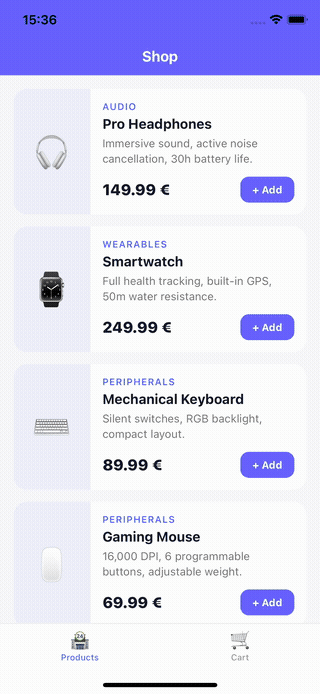

# myshop — PayPal Integration Demo

A React Native / Expo shopping cart app built to demonstrate **four different approaches** to integrating PayPal payments in a mobile application, including a PopupBridge-inspired hybrid mode and the new JS SDK V6.

## Screenshots

| Product listing | Cart | Mode switch |
|:---:|:---:|:---:|
|  |  |  |

| Checkout — WebView JS SDK | Checkout — Native REST API | Checkout — Hybrid |
|:---:|:---:|:---:|
|  |  |  |

### Demo



---

## Purpose

This app is a **demonstration project** designed to compare and showcase four ways to integrate PayPal in a React Native app:

| Mode | Pill label | Approach | Key characteristic |
|---|---|---|---|
| **Native REST API** | `📱 Native` | PayPal REST API v2 + `expo-web-browser` | Requires `CLIENT_SECRET`, full control over the flow |
| **WebView JS SDK** | `🌐 WebView` | PayPal JavaScript SDK (V5) embedded in a WebView | No `CLIENT_SECRET` needed, official web integration |
| **PopupBridge (Hybrid)** | `🔗 Hybrid` | JS SDK V5 in WebView + popup intercepted into `ASWebAuthenticationSession` | Combines web rendering with native session security |
| **JS SDK V6** | `🚀 V6 SDK` | PayPal JavaScript SDK V6 in a WebView | Session-based API, native web components, server-side order management |

The in-app toggle lets you switch between all four modes in real time to observe the differences in behavior and UX.

---

## Features

- **Product listing** — browse 6 products with an add-to-cart animation
- **Cart** — quantity controls, item removal, real-time total
- **Checkout** — shipping form + card payment (simulated) + PayPal (4 modes)
- **PayPal integration toggle** — switch between all four modes directly from the checkout header
- **Order confirmation** — animated success screen

---

## Switching Between PayPal Integration Modes

On the **Checkout** screen, tap the pill badge in the top-right corner of the header:

```
[📱 Native]   →   [🌐 WebView]   →   [🔗 Hybrid]   →   [🚀 V6 SDK]
```

A dialog will appear letting you choose between the four modes. The change is instant.

---

## The Four PayPal Integration Modes

### 📱 Mode 1 — Native REST API

The app talks directly to the PayPal REST API and uses the system browser for the approval step.

**Flow:**
```
App ──── getAccessToken() ─────────────► PayPal API
     ◄─── Bearer token ─────────────────
     ──── createOrder(amount) ──────────►
     ◄─── { orderId, approvalUrl } ─────
     ──── openAuthSessionAsync(approvalUrl) ──► ASWebAuthenticationSession (iOS)
                                                    └─ user logs in & approves
     ◄─── deep-link: myshop://paypal-return?token=EC-XXX
     ──── captureOrder(token) ──────────►
     ◄─── { status: "COMPLETED" } ──────
     ──── navigate → /order-success
```

**Component:** [components/PayPalButton.tsx](components/PayPalButton.tsx)
**API helpers:** [utils/paypal.ts](utils/paypal.ts)

**Pros:** Full control over every step, works offline if you cache the token.
**Cons:** Requires `CLIENT_SECRET` in the app — **never acceptable in production**. Must be moved to a backend server.

---

### 🌐 Mode 2 — WebView JS SDK

The official PayPal JavaScript SDK is embedded in a full-screen `react-native-webview`. The SDK manages everything — order creation, the approval popup, and capture — entirely inside the web context. React Native only receives the final result via `postMessage`.

**Flow:**
```
App ──── render <WebView source={{ html }} /> ──► HTML page (baseUrl: paypal.com)
                                                   └─ paypal.Buttons().render()
                                                   └─ user clicks button
                                                   └─ SDK creates order
                                                   └─ SDK opens approval popup
                                                   └─ user logs in & approves
                                                   └─ SDK captures order
     ◄─── postMessage({ type: 'success', orderId, payerName })
     ──── navigate → /order-success
```

**Component:** [components/PayPalWebViewCheckout.tsx](components/PayPalWebViewCheckout.tsx)
**HTML template:** [utils/paypalCheckoutHtml.ts](utils/paypalCheckoutHtml.ts)

**Pros:** No `CLIENT_SECRET` needed on the client. Official PayPal JS SDK handles all edge cases.
**Cons:** The approval popup opened by the SDK runs inside the WKWebView, which lacks an address bar and HTTPS indicator — a potential spoofing vector. On some iOS versions, `window.open()` from inside a WKWebView is silently blocked, breaking the approval flow entirely.

---

### 🔗 Mode 3 — PopupBridge (Hybrid)

This mode uses the same PayPal JS SDK and the same button rendering as Mode 2, but the approval popup is **intercepted before it opens inside the WebView** and redirected into a native `ASWebAuthenticationSession` — exactly what the [braintree/popup-bridge-ios](https://github.com/braintree/popup-bridge-ios) library does at the native WKWebView delegate level.

**Flow:**
```
App ──── render <WebView source={{ html }} /> ──► HTML page
                                                   ├─ window.popupBridge polyfill injected
                                                   ├─ window.open() override injected
                                                   └─ paypal.Buttons().render()
                                                        └─ user clicks button
                                                        └─ SDK creates order
                                                        └─ SDK calls window.popupBridge.open(approvalUrl)
                                                             OR window.open(approvalUrl) [fallback]
     ◄─── postMessage({ type: 'popup_open', url: approvalUrl })
     ──── openAuthSessionAsync(approvalUrl) ─────► ASWebAuthenticationSession (iOS)
                                                        └─ user logs in & approves
     ◄─── deep-link: myshop://paypal-return?token=EC-XXX&PayerID=XXX
     ──── injectJavaScript("window.onPopupBridgeComplete(returnUrl)")
          └─ if SDK handles popupBridge.onComplete → onApprove() → capture → postMessage('success')
          └─ fallback: extract token, captureOrder(token) from RN side
     ──── navigate → /order-success
```

**Component:** [components/PayPalPopupBridgeCheckout.tsx](components/PayPalPopupBridgeCheckout.tsx)
**HTML template:** [utils/paypalPopupBridgeHtml.ts](utils/paypalPopupBridgeHtml.ts)

**Pros:** Web rendering (JS SDK buttons) + native session security (ASWebAuthenticationSession shows the address bar and HTTPS lock to the user). Resolves the WKWebView popup blocking issue that affects Mode 2.
**Cons:** In this Expo managed-workflow implementation, the interception is done in JavaScript (polyfill + `window.open` override) rather than at the native WKWebView delegate level as `popup-bridge-ios` would do. See [PAYPAL_INTEGRATION.md](./PAYPAL_INTEGRATION.md) for the distinction and the path to a fully native implementation.

---

### 🚀 Mode 4 — JS SDK V6 (WebView)

The new PayPal JavaScript SDK V6 is a complete rewrite of the payment integration experience. Instead of `paypal.Buttons().render()`, it uses **native web components** (`<paypal-button>`) and a **session-based API**. Order creation and capture happen server-side via REST API, and the SDK requires a **`clientToken`** (JWT) obtained from PayPal's OAuth endpoint.

**Flow:**
```
RN ──── getPayPalTokens() ──────────────────► PayPal API
     ◄─── { accessToken, clientToken (JWT) } ──
     ──── render <WebView source={{ html }} /> ──► HTML page (baseUrl: sandbox.paypal.com)
                                                   └─ paypal.createInstance({ clientToken })
                                                   └─ findEligibleMethods({ currencyCode: 'EUR' })
                                                   └─ createPayPalOneTimePaymentSession(callbacks)
                                                   └─ <paypal-button> web component rendered
                                                   └─ user clicks button
                                                   └─ session.start() → REST API creates order
                                                   └─ SDK opens approval popup
                                                   └─ user logs in & approves
                                                   └─ onApprove → REST API captures order
     ◄─── postMessage({ type: 'success', orderId, payerName })
     ──── navigate → /order-success
```

**Component:** [components/PayPalV6WebViewCheckout.tsx](components/PayPalV6WebViewCheckout.tsx)
**HTML template:** [utils/paypalV6CheckoutHtml.ts](utils/paypalV6CheckoutHtml.ts)
**Token helper:** [utils/paypal.ts](utils/paypal.ts) → `getPayPalTokens()`

**Key differences from V5 (Modes 2 & 3):**
| | JS SDK V5 | JS SDK V6 |
|---|---|---|
| SDK script | `paypal.com/sdk/js?client-id=...` | `sandbox.paypal.com/web-sdk/v6/core` |
| Button rendering | `paypal.Buttons().render()` | `<paypal-button>` web component |
| Initialization | Implicit (script loaded) | `paypal.createInstance({ clientToken })` |
| Order creation | `actions.order.create()` (client-side) | REST API (server-side) |
| Capture | `actions.order.capture()` (client-side) | REST API (server-side) |
| Authentication | `CLIENT_ID` only | `clientToken` JWT via OAuth |
| API style | Callback-based | Session-based (`createPayPalOneTimePaymentSession`) |

**Pros:** Modern architecture, server-side order management, payment method eligibility checks, native web components.
**Cons:** Requires `CLIENT_SECRET` for token generation and order management. More complex setup than V5.

---

## Getting Started

### Prerequisites

- Node.js >= 20.19.4
- Expo CLI
- A [PayPal Developer](https://developer.paypal.com) account (sandbox credentials)
- Xcode (for iOS simulator) or Android Studio (for Android emulator)

### Installation

```bash
git clone https://github.com/your-username/myshop.git
cd myshop
npm install
```

### Environment variables

```bash
cp .env.example .env
```

Edit `.env` with your PayPal sandbox credentials:

```env
EXPO_PUBLIC_PAYPAL_CLIENT_ID=your_client_id
EXPO_PUBLIC_PAYPAL_CLIENT_SECRET=your_client_secret   # demo only — never ship this
```

Get your credentials at [developer.paypal.com](https://developer.paypal.com) → **Apps & Credentials** → your sandbox app.

### Running the app

Since this app uses native modules (`expo-web-browser`, `react-native-webview`), you need a **development build** — Expo Go is not supported.

```bash
# iOS simulator (recommended for testing ASWebAuthenticationSession)
npx expo run:ios

# Android emulator
npx expo run:android
```

> The first build takes ~5–10 minutes as Xcode/Gradle compiles native code.
> Subsequent launches use hot reload and are instant.

---

## Project Structure

```
myshop/
├── app/
│   ├── _layout.tsx              Root layout — Stack navigator + providers
│   ├── (tabs)/
│   │   ├── _layout.tsx          Tab bar with dynamic cart badge
│   │   ├── index.tsx            Product listing screen
│   │   └── cart.tsx             Cart screen
│   ├── checkout.tsx             Checkout screen — mode toggle + all four PayPal flows
│   └── order-success.tsx        Animated order confirmation screen
│
├── components/
│   ├── PayPalButton.tsx                Native mode — REST API + WebBrowser
│   ├── PayPalWebViewCheckout.tsx       WebView mode — JS SDK V5 in a WebView
│   ├── PayPalPopupBridgeCheckout.tsx   PopupBridge mode — JS SDK V5 + native session
│   └── PayPalV6WebViewCheckout.tsx     V6 mode — JS SDK V6 + session-based API
│
├── context/
│   ├── CartContext.tsx           Global cart state (useReducer)
│   └── PaymentModeContext.tsx    Active PayPal integration mode ('native' | 'webview' | 'popupbridge' | 'webviewv6')
│
├── utils/
│   ├── paypal.ts                 PayPal REST API helpers (getToken, createOrder, capture, getPayPalTokens)
│   ├── paypalCheckoutHtml.ts     HTML template — PayPal JS SDK V5 (WebView mode)
│   ├── paypalPopupBridgeHtml.ts  HTML template — PayPal JS SDK V5 + PopupBridge polyfill
│   └── paypalV6CheckoutHtml.ts   HTML template — PayPal JS SDK V6 (session-based)
│
├── data/
│   └── products.ts               Static product catalogue
│
├── .env                          Local credentials (gitignored)
├── .env.example                  Credentials template (safe to commit)
└── PAYPAL_INTEGRATION.md         Deep-dive technical documentation for all three modes
```

---

## Security Notes

| | Native REST API | WebView JS SDK V5 | PopupBridge Hybrid | JS SDK V6 | Production target |
|---|---|---|---|---|---|
| `CLIENT_ID` | In `.env` (public) ✅ | In `.env` (public) ✅ | In `.env` (public) ✅ | In `.env` (public) ✅ | OK in client |
| `CLIENT_SECRET` | In `.env` ⚠️ | Not needed ✅ | Not needed ✅ | In `.env` ⚠️ | Backend only |
| Order creation | Client-side ⚠️ | JS SDK (client) | JS SDK (client) | REST API (WebView) ⚠️ | Backend |
| Approval UI | ASWebAuth ✅ | WKWebView ⚠️ | ASWebAuth ✅ | SDK popup (WebView) | ASWebAuth |
| Capture | Client-side ⚠️ | JS SDK (client) | RN or JS SDK | REST API (WebView) ⚠️ | Backend |

For production, the Native REST API mode requires a backend server that holds the `CLIENT_SECRET` and exposes `POST /api/create-order` and `POST /api/capture-order`. See [PAYPAL_INTEGRATION.md](./PAYPAL_INTEGRATION.md) for architecture details and a minimal Node.js implementation.

---

## Testing with Sandbox

1. Go to [developer.paypal.com](https://developer.paypal.com) → **Sandbox → Accounts**
2. Open the **Personal (buyer)** account → **View/Edit account** → note the email and password
3. Use those credentials to log in when PayPal's approval screen appears during testing
4. No real money is involved — all transactions are simulated

---

## Tech Stack

| Package | Version | Role |
|---|---|---|
| `expo` | ~54.0.33 | SDK & toolchain |
| `expo-router` | ~6.0.23 | File-based navigation |
| `react-native` | 0.81.5 | Core framework |
| `expo-web-browser` | ~14.2.0 | `ASWebAuthenticationSession` wrapper (Native + PopupBridge modes) |
| `react-native-webview` | latest | WebView for JS SDK (WebView + PopupBridge modes) |
| TypeScript | ~5.9.2 | Type safety |

---

## Further Reading

See [PAYPAL_INTEGRATION.md](./PAYPAL_INTEGRATION.md) for a deep-dive covering:
- Detailed sequence diagrams for all four modes
- JS SDK V5 vs V6 architecture comparison
- The `popup-bridge-ios` architecture and how this app simulates it
- The difference between a JS polyfill and a native WKWebView delegate implementation
- The path to a fully native PopupBridge integration (bare workflow)
- Production-ready backend architecture for the Native REST API mode
